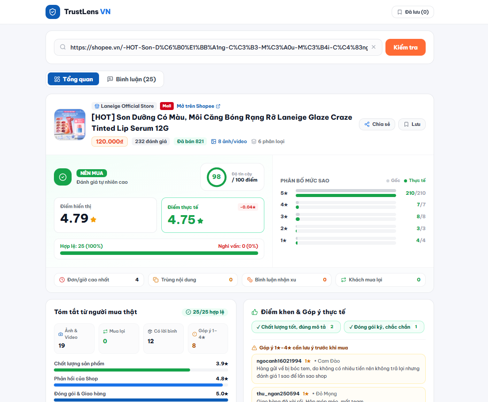
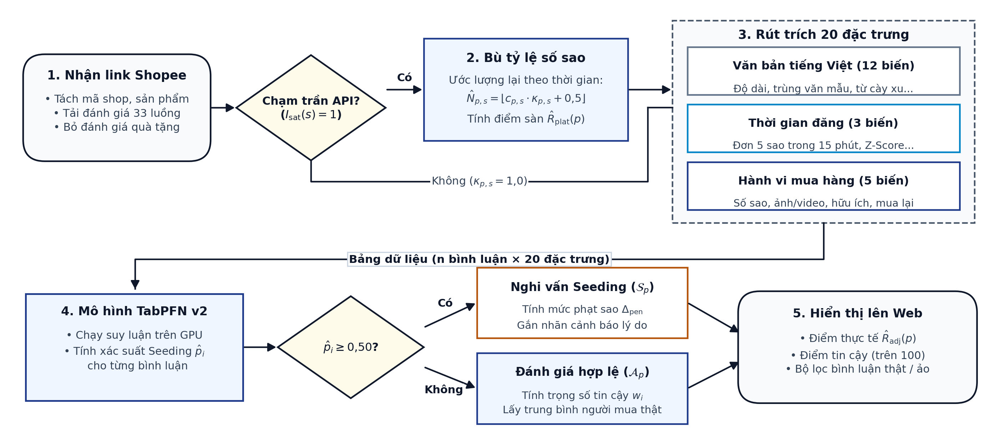
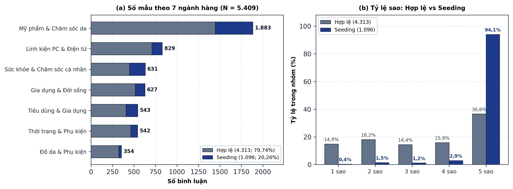
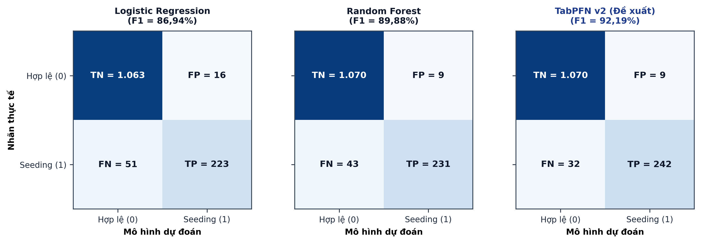
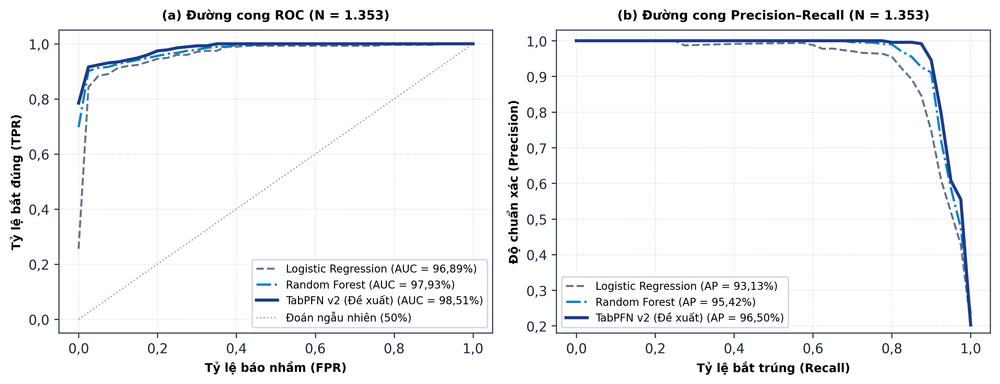
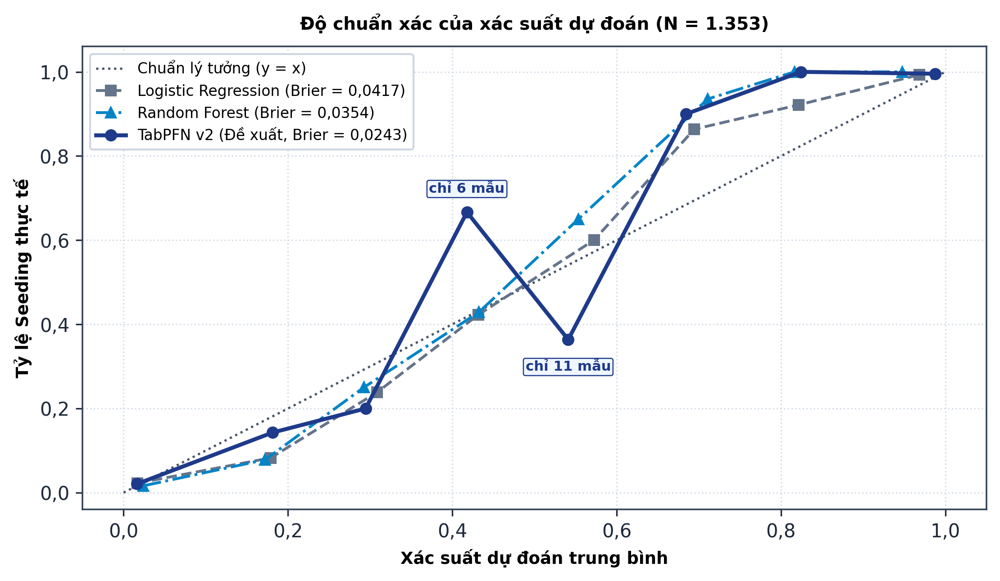
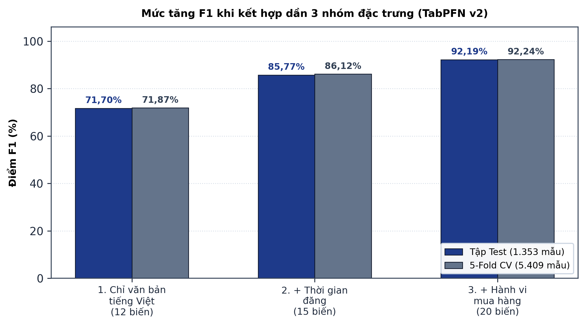
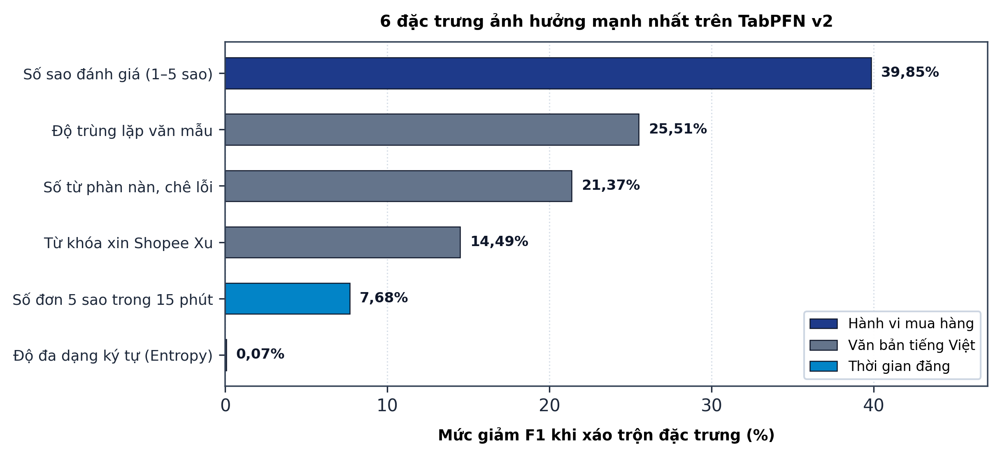

# TrustLens VN - Hệ Thống Lọc Bình Luận Seeding & Tính Lại Điểm Sản Phẩm Shopee

Ứng dụng web hỗ trợ người mua kiểm tra độ tin cậy của bình luận sản phẩm trên sàn **Shopee Việt Nam**. Hệ thống tự động tải đánh giá công khai, bù lại tỷ lệ sao khi chạm trần API, rút trích **20 đặc trưng** (văn bản tiếng Việt, thời gian đăng, hành vi mua hàng), phân loại bằng mô hình **TabPFN v2** và tính lại điểm sao thực tế của sản phẩm.



---

## 1. Luồng Xử Lý Hệ Thống



---

## 2. Hướng Dẫn Chạy Nhanh

### Cách 1: Chạy tự động trên Windows (1-click)
Sau khi cài đặt thư viện ở lần đầu, nhấp đúp vào file:
```bat
start_trustlens.bat
```
- Giao diện Web: `http://localhost:3000`
- Tài liệu API (Swagger): `http://localhost:8001/docs`

### Cách 2: Chạy thủ công bằng dòng lệnh

**Bước 1 – Khởi động Backend (FastAPI, cổng 8001):**
```bash
cd backend
pip install -r requirements.txt
python -m uvicorn app.main:app --host 127.0.0.1 --port 8001 --reload
```
*(Hệ thống tự động nhận diện GPU CUDA nếu máy có card rời NVIDIA, hoặc tự chuyển sang chạy trên CPU nếu máy không có GPU).*

**Bước 2 – Khởi động Frontend (Next.js 14, cổng 3000):**
```bash
cd frontend
npm install
npm run dev
```

---

## 3. Bộ Dữ Liệu Thực Tế Shopee (`N = 5.409`)

Tập dữ liệu huấn luyện và kiểm thử nằm tại `backend/app/models_saved/real_ecommerce_reviews.csv`, gồm **5.409 bình luận tiếng Việt** (lọc từ 17.359 lượt đánh giá thô của 1.499 sản phẩm thuộc 11 gian hàng và 7 nhóm ngành hàng trên Shopee Việt Nam).

| Nhóm nhãn | Mã nhãn | Số mẫu | Tỷ lệ (%) | Mô tả |
| :--- | :--- | :---: | :---: | :--- |
| **Hợp lệ (0)** | `AUTHENTIC` | 4.313 | 79,74% | Đánh giá hợp lệ của người mua thật |
| **Nghi vấn (1)** | `LOW_EFFORT_MISMATCH` | 357 | 6,60% | Chấm 5 sao nhưng nội dung phàn nàn hàng lỗi |
| **Nghi vấn (1)** | `TEMPLATE_COPY_PASTE` | 335 | 6,19% | Bình luận 5 sao sao chép văn mẫu trùng lặp cao |
| **Nghi vấn (1)** | `COIN_FARM_SPAM` | 257 | 4,75% | Bình luận rác đối phó hoặc xin nhận Shopee Xu |
| **Nghi vấn (1)** | `TIME_BURST_HYPE` | 147 | 2,72% | Đơn 5 sao khen sáo rỗng đăng dồn dập trong 15 phút |
| **Tổng cộng** | **2 lớp (0 và 1)** | **5.409** | **100%** | **5.167 nội dung khác nhau, 20 đặc trưng đầu vào** |



---

## 4. Kết Quả Thực Nghiệm & Đánh Giá Mô Hình

Để huấn luyện và xuất lại toàn bộ chỉ số đánh giá vào `backend/app/models_saved/metrics.json`:
```bash
cd backend
python -m app.ml.train_benchmark
```

### 4.1. So sánh 3 mô hình trên 20 đặc trưng (Holdout Test `N = 1.353` & 5-Fold CV `N = 5.409`)

| Mô hình | Acc (%) | Prec (%) | Rec (%) | F1 (%) | ROC-AUC (%) | PR-AUC (%) | MCC (%) | Brier (↓) | 5-Fold CV F1 (TB ± ĐLC) | Độ trễ (ms) |
| :--- | :---: | :---: | :---: | :---: | :---: | :---: | :---: | :---: | :---: | :---: |
| 1. Logistic Regression | 95,05 | 93,31 | 81,39 | 86,94 | 96,89 | 93,13 | 84,20 | 0,0417 | 87,03 ± 2,78% | 24,1 |
| 2. Random Forest | 96,16 | 96,25 | 84,31 | 89,88 | 97,93 | 95,42 | 87,82 | 0,0354 | 90,64 ± 2,60% | 322,7 |
| **3. TabPFN v2 (Đề xuất)** | **96,97** | **96,41** | **88,32** | **92,19** | **98,51** | **96,50** | **90,45** | **0,0243** | **92,24 ± 2,88%** | **5.790,4** |

#### Ma trận nhầm lẫn trên tập kiểm thử độc lập (`N = 1.353`):


#### Đường cong ROC, Precision–Recall và Hiệu chuẩn xác suất (Calibration):




---

### 4.2. Đóng góp của từng nhóm đặc trưng (Ablation Study) & Độ quan trọng biến

| Tổ hợp nhóm đặc trưng | Số biến | F1 Tập Test (%) | ROC-AUC (%) | Brier (↓) | 5-Fold CV F1 |
| :--- | :---: | :---: | :---: | :---: | :---: |
| 1. Chỉ dùng văn bản tiếng Việt (NLP) | 12 | 71,70 *(Gốc)* | 90,66 | 0,0800 | 71,87 ± 3,95% |
| 2. + Nhóm Thời gian đăng | 15 | 85,77 *(+14,07)* | 95,81 | 0,0443 | 86,12 ± 3,81% |
| **3. + Nhóm Hành vi mua hàng Shopee** | **20** | **92,19 *(+20,49)*** | **98,51** | **0,0243** | **92,24 ± 2,88%** |





---

### 4.3. Kiểm chứng trực tuyến trên 3 gian hàng thực tế Shopee

| Gian hàng & Sản phẩm | Ngành hàng | Mẫu quét thô | Sau khi bù tỷ lệ | Điểm thô → Sàn → Thực tế | Nghi vấn & Độ tin cậy |
| :--- | :--- | :---: | :---: | :---: | :---: |
| **MTBH.VN** – Vỏ Case MIK H2 Black | Linh kiện PC | 37 *(chưa chạm trần)* | 37 đánh giá | `4,76 → 4,76 → 4,75★` | 0 mẫu · **98/100** |
| **Longdo Leather** – Ví da bò B03 | Đồ da | 57 *(chạm trần 5★)* | 362 đánh giá | `4,32 → 4,84 → 4,79★` | 1 mẫu · **97/100** |
| **Laneige Official** – Lip Sleeping Mask 20G | Mỹ phẩm | 39 *(chạm trần 5★)* | 234 đánh giá | `4,77 → 4,96 → 4,86★` | 3 mẫu · **89/100** |

---

## 5. Cấu Trúc Thư Mục & Công Nghệ

```text
Trustlens-VN-e-com/
├── backend/
│   ├── app/
│   │   ├── main.py                     # Khởi tạo FastAPI & cấu hình CORS
│   │   ├── api/routes.py               # Các API endpoint (/api/analyze-url, /api/analyze-csv...)
│   │   ├── ml/
│   │   │   ├── crawl_shopee_dataset.py # Script thu thập & tạo bộ dữ liệu 5.409 mẫu Shopee
│   │   │   ├── data_generator.py       # Module tải đánh giá Shopee trực tuyến & bù tỷ lệ sao
│   │   │   ├── feature_engine.py       # Rút trích 20 đặc trưng (12 NLP, 3 Thời gian, 5 Hành vi)
│   │   │   ├── predictor.py            # Suy luận mô hình TabPFN v2 & tính lại điểm sao thực tế
│   │   │   └── train_benchmark.py      # Huấn luyện, kiểm thử Holdout 75/25 & 5-Fold CV
│   │   └── models_saved/               # Lưu dataset CSV, mô hình (.pkl) và kết quả metrics.json
│   └── requirements.txt                # Danh sách thư viện Python
├── frontend/                           # Giao diện Next.js 14 (React 18, TypeScript, Tailwind CSS)
├── results/                            # Biểu đồ kết quả thực nghiệm & ảnh giao diện thực tế
├── start_trustlens.bat                 # Script bật nhanh Backend + Frontend trên Windows
└── README.md
```

- **Backend & Học máy:** Python 3.11, FastAPI, PyTorch, TabPFN v2, Scikit-learn, Pandas, NumPy.
- **Frontend:** Next.js 14, React 18, TypeScript, Tailwind CSS, Lucide Icons.
