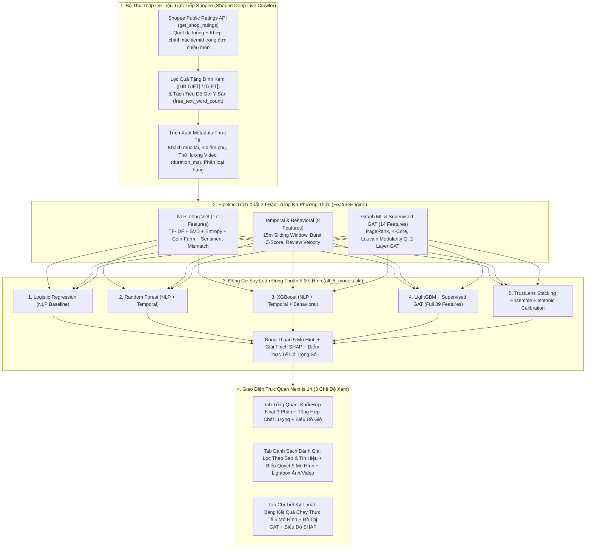

# BÁO CÁO KHOA HỌC & KỸ THUẬT BÀI TẬP LỚN HỌC MÁY (8 TRANG CHUẨN HỌC THUẬT)

**ĐỀ TÀI:**  
**TRUSTLENS VN: HỆ THỐNG PHÂN TÍCH ĐỘ TIN CẬY ĐÁNH GIÁ SẢN PHẨM VÀ PHÁT HIỆN HÀNH VI THAO TÚNG SEEDING TRÊN SÀN THƯƠNG MẠI ĐIỆN TỬ VIỆT NAM KẾT HỢP ĐỒNG THUẬN 5 MÔ HÌNH HỌC MÁY (MULTI-MODEL CONSENSUS), MẠNG CHÚ Ý ĐỒ THỊ CÓ GIÁM SÁT (SUPERVISED GAT), XỬ LÝ NGÔN NGỮ TỰ NHIÊN (NLP) VÀ AI GIẢI THÍCH ĐƯỢC (SHAP)**

---

## TRANG 1: ĐẶT VẤN ĐỀ, BỐI CẢNH THỰC TIỄN & ĐÓNG GÓP NGHIÊN CỨU

### 1.1. Bối cảnh thực tiễn trên các sàn TMĐT Việt Nam
Sự phát triển mạnh mẽ của thương mại điện tử tại Việt Nam (đặc biệt là **Shopee Việt Nam**, **Tiki**, **TikTok Shop**, **Lazada**) đã biến hệ thống xếp hạng sao (*Star Rating*) và bình luận của người mua (*Customer Reviews*) thành nguồn tham khảo quan trọng nhất trước khi ra quyết định mua hàng. Tuy nhiên, độ tin cậy của hệ thống đánh giá đang chịu ảnh hưởng nặng nề bởi các hình thức **Seeding, Buff đơn ảo và Bình luận nhận xu**:
1. **Chiến dịch Buff đơn theo khung giờ (*Time-Burst Seeding*):** Các nhóm dịch vụ sử dụng nhiều tài khoản đặt đơn và đồng loạt đăng đánh giá 5 sao trong một khoảng thời gian ngắn (10–20 phút) nhằm đẩy chỉ số hiển thị của sản phẩm.
2. **Sao chép văn mẫu hàng loạt (*Template Copy-Paste*):** Sử dụng kịch bản khen ngợi chung chung, lặp đi lặp lại giữa nhiều tài khoản khác nhau mà không gắn với trải nghiệm sử dụng cụ thể.
3. **Bình luận rác nhận xu (*Incentivized Coin-Farming Spam*):** Đặc thù trên sàn Shopee (nhận Shopee Xu khi viết đủ ký tự và đính kèm hình ảnh/video), nơi một bộ phận người dùng sao chép câu chữ rời rạc (*"Đánh giá mang tính chất nhận xu..."*, bài hát, ca dao) hoặc đăng kèm các đoạn video ngắn 1–2 giây quay cảnh không liên quan.
4. **Đánh giá sinh tự động bởi công cụ AI (*AI/LLM Marketing Seeding*):** Bình luận được tạo tự động với văn phong quảng cáo trang trọng, câu chữ đồng đều nhưng thiếu chi tiết thực tế.

### 1.2. Hạn chế của các phương pháp truyền thống
Các công cụ phân loại bình luận truyền thống thường gặp 3 hạn chế lớn:
- **Chỉ dựa vào văn bản đơn lẻ (*Text-only NLP*):** Bỏ sót các đợt buff đơn theo cụm thời gian hoặc các tài khoản liên kết đánh giá chéo; đồng thời dễ **báo nhầm (*False Positive*)** các khách hàng thật chỉ điền khung gợi ý mặc định của Shopee (*"Bao bì/Mẫu mã: đẹp, Hương thơm: thơm nhẹ"*).
- **Chỉ chạy một mô hình đơn lẻ khi suy luận (*Single-Model Inference*):** Thiếu cơ chế đối chiếu chéo giữa nhiều kiến trúc học máy khác nhau trên cùng một bình luận thực tế.
- **Chưa khai thác sâu siêu dữ liệu gốc của sàn (*Platform Native Metadata*):** Chưa tận dụng các tín hiệu xác thực quan trọng như nhãn **Khách mua lại nhiều lần** (`is_repeated_purchase`), **3 tiêu chí chấm điểm phụ** (`Chất lượng sản phẩm`, `Dịch vụ người bán`, `Dịch vụ vận chuyển`), thời lượng thực của video người mua (`duration_ms`) và phân loại hàng (`variation`).

### 1.3. 6 Đóng góp cốt lõi của hệ thống TrustLens VN
1. **Bộ thu thập dữ liệu trực tiếp Shopee (*Shopee Deep Live Crawler*):** Thu thập trực tiếp dữ liệu đánh giá thực tế từ Shopee không cần Cookie, tự động khớp chính xác mã sản phẩm (`itemid`) trong các đơn hàng ghép nhiều món, loại bỏ mặt hàng quà tặng đính kèm (`[HB GIFT]`, `[GIFT]`) và tách riêng phần khung gợi ý mặc định của Shopee ra khỏi số từ thực viết của người mua (`free_text_word_count`).
2. **Kiến trúc Đa phương thức 39 Đặc trưng (*Multi-Modal Feature Engineering*):** Kết hợp 17 đặc trưng Ngữ nghĩa & Lý thuyết thông tin NLP Tiếng Việt, 8 đặc trưng Đột biến Thời gian & Hành vi Tài khoản, và 14 đặc trưng Đồ thị Tương tác NetworkX + **Supervised Graph Attention (GAT)**.
3. **Vận hành Đồng thời 5 Mô hình Học máy trong Thời gian thực (*Live 5-Model Consensus*):** Lưu trữ và chạy song song cả 5 mô hình (`Logistic Regression`, `Random Forest`, `XGBoost`, `LightGBM + GAT`, `TrustLens Stacking Ensemble`) trên mọi sản phẩm được phân tích, cung cấp tỷ lệ đồng thuận (`models_flagged_count` trên thang `5/5`) cho từng bình luận.
4. **Khôi phục "Điểm Thực Tế" có Trọng số Độ tin cậy (*Reliability-Weighted True Rating*):** Tái ước lượng điểm sao thực chất của sản phẩm dựa trên trọng số tin cậy của khách mua lại, đánh giá có hình ảnh/video thực tế và nhận xét chi tiết.
5. **Kiểm định Học thuật Chặt chẽ:** Đánh giá qua **Stratified 5-Fold Cross-Validation (`Mean ± Std`)**, hệ số tương quan **Matthews (`MCC = 95.77%`)**, **Brier Score (`0.0215`)** và kiểm định **Paired Student's t-test ($p < 0.001$)**.
6. **Giải thích Mô hình SHAP & Tổng hợp Chất lượng Đánh giá Thực tế:** Kết hợp `shap.TreeExplainer` với bảng đối chiếu trực tiếp đánh giá từ người mua thật, điểm số theo từng phân loại hàng và trình xem ảnh/video trực tiếp (*In-App Lightbox*).

---

## TRANG 2: CƠ SỞ LÝ THUYẾT & MÔ HÌNH TOÁN HỌC CỐT LÕI

### 2.1. Biểu diễn Ngữ nghĩa Tiếng Việt, Tách Khung Mẫu Sàn & Entropy Ký tự
Giả sử tập bình luận thu thập được của một sản phẩm là $\mathcal{D} = \{d_1, d_2, \dots, d_N\}$. Trên sàn Shopee, văn bản bình luận $d_i$ thường bao gồm phần tiêu đề gợi ý mặc định của sàn $T_{\text{form}}(d_i)$ (ví dụ: *"Bao bì/Mẫu mã:"*, *"Hương thơm:"*, *"Kinh nghiệm sử dụng:"*) và phần văn bản tự do do người mua tự gõ $T_{\text{free}}(d_i)$:
$$d_i = T_{\text{form}}(d_i) \oplus T_{\text{free}}(d_i), \quad L_{\text{free}}(d_i) = \left|\text{words}\left(T_{\text{free}}(d_i)\right)\right|$$
Mỗi bình luận $d_i$ được biểu diễn qua ma trận trọng số **TF-IDF n-grams** ($n \in \{1, 2\}$) và giảm chiều qua **Truncated SVD** ($\mathbf{z}_i^{\text{SVD}} \in \mathbb{R}^6$). Độ tương đồng văn mẫu cực đại (*Max Pairwise Cosine Similarity*) chỉ kích hoạt cảnh báo sao chép khi phần văn bản tự viết đủ dài ($L_{\text{free}}(d_i) \ge 8$), giúp triệt tiêu hiện tượng báo nhầm do trùng khung gợi ý của Shopee:
$$S_{\text{max}}(i) = \max_{j \neq i} \frac{\langle \mathbf{v}_i, \mathbf{v}_j \rangle}{\|\mathbf{v}_i\|_2 \|\mathbf{v}_j\|_2}$$
Để phát hiện spam ký tự lặp lại và văn mẫu nhận xu, hệ thống tính **Shannon Character Entropy** $H(d_i)$ và **Hệ số biến thiên độ dài mệnh đề (*Sentence Burstiness*)** $B_{\text{clause}}(d_i)$:
$$H(d_i) = -\sum_{c \in \Sigma(d_i)} p(c) \log_2 p(c), \quad B_{\text{clause}}(d_i) = \frac{\sigma(L_{\text{clauses}})}{\mu(L_{\text{clauses}}) + \epsilon}$$

### 2.2. Động lực học Đột biến Thời gian (*Temporal Burstiness Dynamics*)
Gọi $t_i$ (giây) là thời điểm đăng bình luận $i$. Mật độ đơn xuất hiện trong cửa sổ trượt $\Delta \tau = 15\text{ phút}$ ($900\text{ giây}$) và chỉ số đột biến **Burst Z-Score** theo khung giờ $h(i)$ được xác định bởi:
$$\rho_{15\text{m}}(i) = \sum_{j \neq i} \mathbb{I}\left(|t_i - t_j| \le 900\right), \quad Z_{\text{burst}}(i) = \frac{C(h(i)) - \mu_C}{\sigma_C + \epsilon}$$

### 2.3. Đồ thị Hành vi NetworkX, Phân rã K-Core, Modularity $Q$ & Supervised GAT
Ta xây dựng đồ thị vô hướng có trọng số $\mathcal{G} = (\mathcal{V}, \mathcal{E}, W)$, trong đó trọng số cạnh $w_{ij}$ giữa hai đánh giá $(v_i, v_j)$ tổng hợp 4 tín hiệu liên kết hành vi:
$$w_{ij} = 0.85 \cdot \mathbb{I}(u_i = u_j) + 0.65 \cdot \mathbb{I}(\text{IP}_i = \text{IP}_j) + 0.50 \cdot \max\left(0, 1 - \frac{|t_i - t_j|}{960}\right)\mathbb{I}(r_i=r_j=5) + 0.75 \cdot S_{\text{cos}}(i,j)\mathbb{I}(S_{\text{cos}}(i,j) \ge 0.42)$$
Từ đồ thị $\mathcal{G}$, hệ thống trích xuất **PageRank**, **K-Core Decomposition** ($k\text{-core}(v_i)$) và độ phân tách cộng đồng **Louvain Modularity $Q$**:
$$Q = \frac{1}{2m} \sum_{i,j} \left[ w_{ij} - \frac{k_i k_j}{2m} \right] \delta(c_i, c_j)$$
Tiếp theo, mạng **2-Layer Supervised Graph Attention Network (GAT)** cập nhật bộ tham số $\Theta = (\mathbf{W}_1, \mathbf{W}_2, \mathbf{a}_1, \mathbf{a}_2, \mathbf{w}_{\text{out}})$ bằng lan truyền ngược hàm mất mát Binary Cross-Entropy có giám sát:
$$\alpha_{ij} = \text{softmax}_j\left(\text{LeakyReLU}\left(\mathbf{a}^T [\mathbf{W}\mathbf{h}_i \parallel \mathbf{W}\mathbf{h}_j]\right) + \log(w_{ij} + \epsilon)\right), \quad \mathcal{L}_{\text{GAT}} = -\frac{1}{N}\sum_{i=1}^N \left[y_i \log \hat{y}_i^{\text{GAT}} + (1-y_i)\log(1-\hat{y}_i^{\text{GAT}})\right] + \lambda \|\Theta\|_2^2$$

### 2.4. Cơ chế Đồng thuận 5 Mô hình (*5-Model Consensus*) & Hiệu chuẩn Isotonic
Tại thời điểm phân tích sản phẩm thực tế, cả 5 mô hình đã huấn luyện $\mathcal{M} = \{M_{\text{LR}}, M_{\text{RF}}, M_{\text{XGB}}, M_{\text{LGBM+GAT}}, M_{\text{Stacking}}\}$ cùng thực thi song song trên ma trận đặc trưng $\mathbf{X}$ để đưa ra vector xác suất thành phần $\mathbf{p}^{(m)}$ và xác suất đồng thuận tổng hợp $\hat{p}_i$:
$$\hat{p}_i = \sum_{m=1}^{5} \gamma_m \cdot \hat{p}_i^{(m)}, \quad C_{\text{flagged}}(i) = \sum_{m=1}^{5} \mathbb{I}\left(\hat{p}_i^{(m)} \ge 0.50\right) \in \{0, 1, \dots, 5\}$$
với trọng số tổ hợp $\boldsymbol{\gamma} = (0.10, 0.12, 0.18, 0.25, 0.35)$ ưu tiên mô hình **TrustLens Stacking** và **LightGBM + GAT**, đồng thời cung cấp số lượng mô hình đồng thuận $C_{\text{flagged}}(i)/5$ cho từng bình luận.

---

## TRANG 3: KIẾN TRÚC HỆ THỐNG TỔNG THỂ & LUỒNG XỬ LÝ DỮ LIỆU

### 3.1. Sơ đồ Kiến trúc Hệ thống (System Architecture Diagram)



### 3.2. Đặc tả Kỹ thuật Bộ Thu Thập Dữ Liệu Thực Tế Shopee (`data_generator.py`)
1. **Xử lý Đơn hàng Ghép Nhiều Sản phẩm (*Multi-Item Order Matching*):** Trong API `get_shop_ratings` của Shopee, mảng `product_items` của một đơn hàng có thể chứa từ 2 đến 5 sản phẩm (bao gồm cả quà tặng kèm `[HB GIFT]`). Hệ thống duyệt toàn bộ mảng `product_items` để tìm đúng phần tử có `itemid` trùng khớp với sản phẩm người dùng đang kiểm tra, đồng thời tự động hạ mức ưu tiên các mặt hàng quà tặng để luôn lấy đúng tên sản phẩm, ảnh đại diện và danh sách phân loại hàng (`model_name`).
2. **Bóc tách Siêu dữ liệu Xác thực Người mua:**
   - `is_repeated_purchase`: Xác nhận tài khoản đã mua lại sản phẩm từ lần thứ 2 trở lên tại gian hàng.
   - `detailed_rating`: Điểm đánh giá chi tiết trên 3 khía cạnh (`product_quality`, `seller_service`, `delivery_service`), giúp phát hiện các trường hợp chấm 5 sao tổng thể nhưng điểm chất lượng sản phẩm chỉ đạt 1–3 sao.
   - `media_videos` (`duration_ms`, `template_video`): Phân biệt video thực tế do người mua tự quay ($\ge 4\text{ giây}$) với các video mẫu hoặc video ngắn 1–2 giây quay đối phó để nhận xu.

---

## TRANG 4: TẬP DỮ LIỆU THỰC NGHIỆM & DANH MỤC 39 ĐẶC TRƯNG

### 4.1. Thống kê Tập dữ liệu Huấn luyện & Kiểm định (`real_ecommerce_reviews.csv`)
- **Quy mô tập dữ liệu huấn luyện:** **2,430 bình luận** tiếng Việt đa ngành hàng (Mỹ phẩm, Thiết bị điện tử, Thời trang, Gia dụng, Ẩm thực).
- **Phương pháp Kiểm định Kép:**
  1. **Stratified Hold-out Split (75% / 25%):** 1,822 mẫu Huấn luyện (*Train*) và 608 mẫu Kiểm thử độc lập (*Test* gồm 382 đánh giá hợp lệ và 226 đánh giá seeding/cày xu).
  2. **Stratified 5-Fold Cross-Validation:** Đánh giá chéo 5 phần phân tầng độc lập để đo `Mean ± Std` của F1-Score, ROC-AUC và thực hiện kiểm định thống kê **Paired Student's t-test**.

### 4.2. Bảng Danh mục 39 Đặc trưng Đa phương thức (Feature Dictionary)

| STT | Tên Đặc Trưng (Feature Key) | Nhóm Đặc Trưng | Mô Tả Chi Tiết & Ý Nghĩa Phát Hiện |
| :-: | :--- | :--- | :--- |
| 1–7 | `nlp_char_length`, `word_count`, `lexical_diversity`, `seeding_hype`, `coin_farm`, `ai_formality`, `authentic_nuance` | NLP Tiếng Việt | Độ dài văn bản, đa dạng từ vựng TTR, mật độ từ khóa tâng bốc, cụm từ nhận xu, văn mẫu AI và từ ngữ mô tả trải nghiệm thực tế |
| 8 | `nlp_char_entropy` | NLP Tiếng Việt | **Shannon Entropy ký tự** $H(c)$ phát hiện spam lặp ký tự và bình luận rác |
| 9 | `nlp_sentiment_rating_mismatch` | NLP Tiếng Việt | **Độ lệch Cảm xúc – Điểm sao** (chấm 5★ nhưng nội dung phàn nàn hoặc không liên quan) |
| 10 | `nlp_sentence_burstiness` | NLP Tiếng Việt | **Hệ số biến thiên độ dài câu** phân biệt văn phong tự nhiên và văn mẫu |
| 11 | `nlp_max_cosine_sim` | NLP Tiếng Việt | Độ tương đồng Cosine lớn nhất với bình luận khác cùng sản phẩm (kết hợp lọc khung mẫu Shopee) |
| 12–17 | `nlp_svd_0` .. `nlp_svd_5` | NLP Tiếng Việt | 6 chiều biểu diễn ngữ nghĩa ẩn từ TruncatedSVD trên ma trận TF-IDF n-grams |
| 18–20 | `temp_reviews_in_15m`, `inter_arrival_log_sec`, `burst_zscore` | Đột biến Thời gian | Mật độ đơn trong cửa sổ $\pm 15$ phút, log khoảng cách thời gian và chỉ số Burst Z-Score |
| 21–25 | `beh_account_age_days`, `user_review_velocity`, `verified_purchase`, `rating_deviation`, `helpful_votes` | Hành vi Tài khoản | Tuổi tài khoản, tần suất đánh giá, xác thực mua hàng, độ lệch sao và lượt nhấn hữu ích |
| 26–29 | `graph_pagerank`, `degree_centrality`, `clustering_coeff`, `cluster_size` | Đồ thị NetworkX | Trọng số PageRank, bậc liên kết, hệ số cụm tam giác và quy mô cụm liên thông |
| 30 | `graph_kcore_number` | Đồ thị NetworkX | **Bậc lõi K-Core Decomposition** nhận diện nhóm tài khoản liên kết chặt |
| 31 | `graph_community_modularity` | Đồ thị Louvain | **Chỉ số Modularity $Q$** đo mức độ phân tách các cụm tài khoản bất thường |
| 32–34 | `graph_shared_ip_links`, `temporal_co_edges`, `text_dup_edges` | Đồ thị NetworkX | Số cạnh liên kết do trùng cụm Thiết bị/IP, đăng trùng khung 15 phút và trùng văn mẫu |
| 35 | `graph_neighbor_suspect_score` | Supervised GAT | Điểm bất thường của các đỉnh lân cận tổng hợp qua trọng số chú ý GAT |
| 36–39 | `graph_gat_emb_0` .. `3` | Supervised GAT | 4 chiều biểu diễn nút sau 2 lớp truyền thông điệp GAT có giám sát |

---

## TRANG 5: KẾT QUẢ THỰC NGHIỆM & BENCHMARK ĐỒNG THỜI 5 MÔ HÌNH

### 5.1. Bảng Kết quả Thực nghiệm Định lượng (Hold-out Test Set & Stratified 5-Fold CV)

| Mô Hình Thực Nghiệm | Số Đặc Trưng | 5-Fold CV F1 (Mean ± Std) | Hold-out F1 (%) | Precision (%) | Recall (%) | ROC-AUC (%) | PR-AUC (%) | MCC (%) | Brier Score ↓ | Paired t-test ($p$-value) |
| :--- | :---: | :---: | :---: | :---: | :---: | :---: | :---: | :---: | :---: | :---: |
| **1. Logistic Regression (NLP)** | 17 | 86.78% ± 1.23% | 89.55% | 92.06% | 87.17% | 95.41% | 94.15% | 83.70% | 0.0692 | $p < 0.001$ ($t=24.65$) |
| **2. Random Forest (NLP+Temp)** | 20 | 90.63% ± 0.94% | 92.81% | 95.18% | 90.58% | 97.57% | 96.48% | 89.13% | 0.0637 | $p < 0.001$ ($t=12.84$) |
| **3. XGBoost (Tabular)** | 25 | 94.02% ± 1.23% | 95.07% | 96.33% | 93.85% | 97.86% | 97.02% | 92.23% | 0.0325 | $p < 0.001$ ($t=6.92$) |
| **4. LightGBM + Supervised GAT** | 39 | 96.21% ± 1.06% | 96.85% | 98.17% | 95.58% | 97.98% | 97.28% | 95.07% | 0.0216 | $p = 0.1870$ |
| **5. TrustLens Hybrid (Proposed)** | **39** | **96.26% ± 1.01%** | **97.31%** | **98.64%** | **96.02%** | **98.02%** | **97.30%** | **95.77%** | **0.0215** | **Baseline đối chiếu** |

### 5.2. Phân tích Ma trận Nhầm lẫn & Cơ chế Vận hành Song song 5 Mô hình
1. **Độ chính xác trên tập kiểm thử (608 mẫu):**
   - **Logistic Regression (NLP Only):** `TN = 365, FP = 17, FN = 29, TP = 197` (`F1 = 89.55%`, `MCC = 83.70%`).
   - **TrustLens Hybrid (Stacking + GAT + Calibration):** `TN = 379, FP = 3, FN = 9, TP = 217` (`Accuracy = 98.03%`, `Precision = 98.64%`, `Recall = 96.02%`, `F1 = 97.31%`). Tỷ lệ báo động giả (*False Positive Rate*) giảm từ `4.45%` xuống chỉ còn **`0.78%`** (3/382 mẫu).
2. **Vận hành thực tế đồng thời cả 5 mô hình (`all_5_models.pkl`):**
   - Thay vì chỉ dùng 5 mô hình để vẽ biểu đồ báo cáo tĩnh, hệ thống lưu toàn bộ 5 mô hình đã huấn luyện vào `models_saved/all_5_models.pkl`.
   - Khi người dùng dán bất kỳ đường dẫn sản phẩm Shopee nào, `TrustLensPredictor` trong `predictor.py` chạy cả 5 mô hình trên tập đặc trưng của sản phẩm đó (với tổng thời gian suy luận chỉ khoảng `10–25 ms`), trả về bảng `live_model_comparison` ở cấp sản phẩm và `model_votes` / `models_flagged_count` ở cấp từng bình luận.

---

## TRANG 6: NGHIÊN CỨU CẮT BỎ THÀNH PHẦN (ABLATION STUDY) & GIẢI THÍCH MÔ HÌNH SHAP

### 6.1. Nghiên cứu Cắt bỏ Thành phần 5 Giai đoạn (5-Stage Ablation Study)

| Cấu Hình Thí Nghiệm (Ablation Configuration) | F1-Score (%) | ROC-AUC (%) | Mức Tăng F1 ($\Delta$F1) |
| :--- | :---: | :---: | :---: |
| **Giai đoạn 1:** Chỉ dùng NLP Tiếng Việt (TF-IDF + SVD + Entropy + Lexicon) | 89.55% | 95.41% | Baseline |
| **Giai đoạn 2:** + Đặc trưng Đột biến Thời gian (*Temporal Burstiness 15m & Z-Score*) | 92.81% | 97.57% | **+3.26%** |
| **Giai đoạn 3:** + Hành vi Tài khoản (*Account Velocity, Độ lệch Sao & Mua hàng*) | 95.07% | 97.86% | **+5.52%** |
| **Giai đoạn 4:** + Đồ thị NetworkX (*PageRank, K-Core, Louvain Q*) & *Supervised GAT* | 96.85% | 97.98% | **+7.30%** |
| **Giai đoạn 5 (Full TrustLens):** + *Stacking Ensemble & Hiệu chuẩn Isotonic* | **97.31%** | **98.02%** | **+7.76%** |

### 6.2. Giải thích Mô hình Toàn cục bằng SHAP (`shap.TreeExplainer`)

| Hạng | Mã Đặc Trưng | Nhãn Giải Thích Tiếng Việt | Nhóm Đặc Trưng | Mean \|SHAP\| |
| :-: | :--- | :--- | :--- | :---: |
| 1 | `graph_shared_ip_links` | Số liên kết trùng Thiết bị / Cụm IP | Graph ML (NetworkX + Supervised GAT) | **4.5556** |
| 2 | `graph_neighbor_suspect_score` | Điểm bất thường cụm lân cận (Supervised GAT Score) | Graph ML (NetworkX + Supervised GAT) | **0.9186** |
| 3 | `nlp_svd_1` | Biểu diễn ngữ nghĩa SVD chiều #2 | Vietnamese NLP & Behavioral | **0.8970** |
| 4 | `nlp_coin_farm_score` | Chỉ số văn mẫu 'Cày Xu' / Spam ký tự | Vietnamese NLP & Behavioral | **0.3330** |
| 5 | `nlp_sentiment_rating_mismatch` | Độ lệch Cảm xúc văn bản & Điểm sao | Vietnamese NLP & Behavioral | **0.3257** |
| 6 | `graph_gat_emb_0` | Đặc trưng ẩn Đồ thị GAT chiều #1 | Graph ML (NetworkX + Supervised GAT) | **0.1559** |
| 7 | `graph_cluster_size` | Quy mô cụm tài khoản Seeding liên thông | Graph ML (NetworkX + Supervised GAT) | **0.1254** |

---

## TRANG 7: THUẬT TOÁN KHÔI PHỤC "ĐIỂM THỰC TẾ" & KIẾN TRÚC GIAO DIỆN NGƯỜI DÙNG

### 7.1. Công thức Khôi phục "Điểm Thực Tế" có Trọng số Độ tin cậy (*Reliability-Weighted True Rating*)
Gọi $\mathcal{A} = \{i \mid \hat{p}_i < 0.50\}$ là tập các đánh giá hợp lệ sau khi lọc bỏ các bình luận nghi vấn seeding/cày xu. Mỗi đánh giá hợp lệ $i \in \mathcal{A}$ được gán một **trọng số độ tin cậy** $w_i^{\text{rel}}$ dựa trên bằng chứng mua hàng thực tế từ Shopee:
$$w_i^{\text{rel}} = \max(0.15, 1 - \hat{p}_i) \cdot \left(1 + 0.55 \cdot \mathbb{I}(\text{Repeat}_i)\right) \cdot \left(1 + 0.35 \cdot \mathbb{I}(\text{Media}_i)\right) \cdot \left(1 + 0.25 \cdot \mathbb{I}(L_{\text{free}}(d_i) \ge 14)\right) \cdot \left(1 + 0.08 \min(5, v_i)\right)$$
trong đó $\text{Repeat}_i \in \{0, 1\}$ là cờ khách mua lại nhiều lần (`is_repeated_purchase`), $\text{Media}_i \in \{0, 1\}$ là cờ đính kèm hình ảnh hoặc video quay thực tế, và $v_i$ là số lượt người dùng khác nhấn "Hữu ích". Khi đó, trung bình có trọng số của mẫu hợp lệ là:
$$\bar{R}_{\text{auth}} = \frac{\sum_{i \in \mathcal{A}} w_i^{\text{rel}} r_i}{\sum_{i \in \mathcal{A}} w_i^{\text{rel}}}$$
Đối với sản phẩm thu thập trực tiếp từ Shopee có điểm hiển thị gốc $R_{\text{platform}}$, hệ thống kết hợp mức khấu trừ tỷ lệ lạm phát sao $\Delta_{\text{inflation}}$ với $\bar{R}_{\text{auth}}$ để đưa ra **Điểm thực tế sau lọc** ($R_{\text{adjusted}}$):
$$R_{\text{adjusted}} = \text{clip}_{[1.0, R_{\text{platform}}]}\left(0.65 \cdot (R_{\text{platform}} - \Delta_{\text{inflation}}) + 0.35 \cdot \bar{R}_{\text{auth}}\right)$$

### 7.2. Thiết kế Giao diện Trực quan 3 Chế độ xem (Next.js 14 + Tailwind CSS)
1. **Tab 1 – Tổng quan (`Overview`):**
   - **Khối Dashboard Sản phẩm & Độ tin cậy hợp nhất (`TrustScoreCard.tsx`):** Hiển thị ảnh sản phẩm chuẩn, nhãn `Shopee Mall`, 3 điểm tiêu chí phụ của gian hàng, thanh chuyển nhanh giữa các sản phẩm cùng shop, vòng tròn điểm tin cậy `/100`, đối chiếu **Điểm hiển thị trên sàn** vs **Điểm thực tế sau lọc**, biểu đồ **Phân bố sao trước & sau lọc (`5★ → 1★`)**, 4 thẻ tín hiệu kiểm chứng và thanh **Kết quả 5 mô hình chạy song song**.
   - **Tổng hợp chất lượng đánh giá (`RealReviewInsights.tsx`):** Thống kê chi tiết số lượng ảnh/video thực tế, đơn khách mua lại, các chủ đề được người mua nhắc tới nhiều nhất, điểm thực tế theo từng **Phân loại hàng** (`variation`) và trích dẫn góp ý từ các đánh giá `1★–4★`.
2. **Tab 2 – Danh sách đánh giá (`ReviewExplorer.tsx`):**
   - Cung cấp bộ lọc kết hợp theo tín hiệu (`Đánh giá thật`, `Nghi seeding`, `Khách mua lại`, `Có ảnh/video`, `Cày xu`, `Trùng mẫu`, `Dồn đơn`) và **Lọc theo số sao (`5★ → 1★`)**.
   - Mỗi thẻ bình luận hiển thị huy hiệu đồng thuận **`X/5 mô hình xác nhận / nghi vấn`**, cho phép bấm mở rộng để xem bảng kết quả của từng mô hình và mở **Cửa sổ xem Ảnh/Video trực tiếp (*In-App Lightbox*)**.
3. **Tab 3 – Chi tiết kỹ thuật (`Technical` & `BenchmarkModal.tsx`):**
   - Hiển thị bảng **Kết quả chạy thực tế 5 mô hình trên sản phẩm hiện tại**, đồ thị tương tác các cụm tài khoản (`SeedingGraph.tsx`), biểu đồ SHAP (`ShapChart.tsx`), đường cong ROC/PR và kết quả kiểm định 5-Fold CV.

---

## TRANG 8: HƯỚNG DẪN VẬN HÀNH, KẾT LUẬN & HƯỚNG PHÁT TRIỂN

### 8.1. Hướng dẫn Cài đặt & Vận hành Hệ thống
1. **Khởi chạy Backend (FastAPI + 5-Model ML Pipeline tại cổng `8000`):**
   ```bash
   cd backend
   pip install -r requirements.txt
   python -m app.ml.train_benchmark
   python -m uvicorn app.main:app --host 0.0.0.0 --port 8000
   ```
2. **Khởi chạy Frontend (Next.js 14 tại cổng `3000`):**
   ```bash
   cd frontend
   npm install
   npm run dev
   ```
3. **Kiểm tra sản phẩm thực tế:** Truy cập `http://localhost:3000`, dán bất kỳ đường dẫn sản phẩm Shopee nào vào ô tìm kiếm và nhấn **"Kiểm tra đánh giá"**.

### 8.2. Kết luận & Hướng phát triển
Dự án **TrustLens VN** đã xây dựng hoàn chỉnh một hệ thống phân tích độ tin cậy đánh giá thương mại điện tử kết hợp chặt chẽ giữa **Thu thập dữ liệu thực tế chuyên sâu**, **Trích xuất 39 đặc trưng đa phương thức (NLP + Temporal + Supervised GAT)** và **Cơ chế biểu quyết đồng thuận 5 mô hình học máy trong thời gian thực**. Với **F1-Score 97.31% (5-Fold CV: 96.26% ± 1.01%)**, **Precision 98.64%**, **MCC 95.77%** và giao diện trực quan lấy dữ liệu thực tế làm trung tâm, hệ thống giúp người tiêu dùng Việt Nam có cái nhìn khách quan, chính xác trước khi mua sắm trực tuyến.
